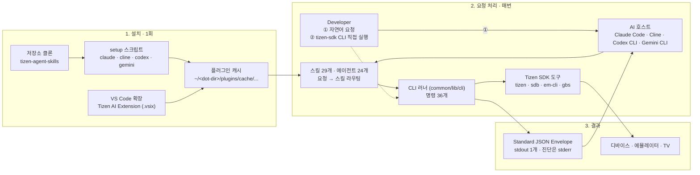
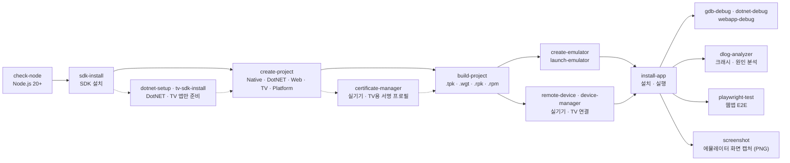

# tizen-sdk-skills 가이드

v1.6.0 이후 `main` 기준 (2026-10-26) · 한 장 요약본 (상세 내용은 README.ko.md)

## 1. tizen-sdk-skills란

**tizen-sdk-skills는 AI 코딩 에이전트에게 자연어로 요청하면 Tizen SDK 도구를 대신 실행해 주는 타이젠 앱 개발 자동화 스킬셋입니다.**



- 지원 호스트: Claude Code, Cline, Codex CLI, Gemini CLI, VS Code 확장, tizen-sdk CLI
- 전 과정 자동화: SDK 설치 → 프로젝트 생성 → 빌드 → 에뮬레이터/디바이스 설치 → 원격 디버깅(GDB / netcoredbg / CDP) → Playwright 테스트
- 결과물: 모든 명령이 stdout에 Standard JSON Envelope 하나를 출력합니다. 진단 메시지는 stderr로만 나갑니다.
- 실행 방식: AI 호스트에 말로 요청하는 **자연어 실행**과, 호스트 없이 터미널·CI에서 쓰는 **CLI 실행**이 있습니다. 둘 다 같은 러너를 사용합니다.
- 안전장치: 앱 제거, 앱 종료, 재부팅, root 전환, 공장 초기화, 로그 지우기처럼 되돌리기 어려운 동작은 실행할 명령을 먼저 보여 주고 확인을 받은 뒤 실행합니다.

### 1.1 자연어 요청 처리

명령어를 외울 필요 없이 한국어나 영어로 원하는 작업을 말하면 됩니다.

| 단계 | 내용 |
|------|------|
| 요청 | "이 프로젝트 빌드해서 에뮬레이터에 설치해줘"처럼 원하는 작업을 말합니다. |
| 라우팅 | 요청이 맞는 스킬(`tizen-build-project`, `tizen-install-app` 등)로 연결됩니다. |
| 실행 | 스킬이 설치된 SDK를 찾아 `tizen` / `sdb` / `em-cli` 명령을 실행합니다. |
| 결과 | Standard JSON Envelope로 결과를 돌려주고, 어시스턴트가 이를 요약해 보여 줍니다. |

대부분의 스킬 이름은 `tizen-<명령어>`(예: `tizen-build-project`)이고, CLI에서는 같은 명령을 `tizen-sdk <명령어>`로 실행합니다. `list-templates`, `platform-list` 같은 일부 명령은 다른 스킬을 통해 실행됩니다.

## 2. 전체 개발 흐름



| 도메인 | 명령 (36개) |
|--------|-------------|
| SDK | `sdk-init`, `sdk-install`, `sdk-install-custom-repo`, `validate-repo-url`, `tv-sdk-install`, `tv-sdk-install-from-zip`, `update-package`, `sdk-repo-info`, `download-emulator-package`, `platform-install`, `platform-list`, `download-mobile-platform`, `install-rootstrap`, `dotnet-setup` |
| Check | `check-node`, `check-disk-space` |
| Project | `create-project`, `project-delete`, `list-templates`, `import-wgt`, `build-project` |
| Device | `create-emulator`, `launch-emulator`, `emulator-manager`, `device-manager`, `install-app`, `sdb-helper`, `screenshot`, `file-transfer`, `remote-device` |
| Debug | `gdb-debug`, `dotnet-debug`, `webapp-debug`, `dlog-analyzer` |
| Test | `playwright-test` |
| Certificate | `certificate-manager` |

> 점선은 필요할 때만 거치는 단계입니다. DotNET 앱은 `dotnet-setup`, TV 앱은 `tv-sdk-install`이 먼저 필요하고, 실기기·TV에 설치하려면 서명 프로필(`certificate-manager`)과 디바이스 연결(`remote-device`)이 필요합니다.

## 3. Quick Start — 설치하고 첫 요청하기

1. 사전 요구사항을 준비합니다. Tizen SDK는 미리 설치하지 않아도 됩니다.
   - Node.js 20+ (`PATH`에 있어야 함), Git
   - OS: Windows, Linux, macOS. 에뮬레이터는 WSL에서도 동작합니다.
   - tizen-sdk CLI를 직접 빌드할 때만 pnpm
2. 저장소를 클론합니다.
3. 사용하는 호스트의 setup 스크립트를 실행합니다.
4. 호스트를 재시작하고 **"타이젠 SDK 설치해줘"**부터 요청합니다.

```bash
git clone https://github.com/Samsung/tizen-agent-skills.git
cd tizen-agent-skills/tizen-sdk-skills
```

| 호스트 | 설치 명령 (Linux/macOS · Windows) | 설치 후 |
|--------|-----------------------------------|---------|
| Claude Code | `bash claude/setup/setup.sh` · `.\claude\setup\setup.ps1` | 세션 재시작 |
| Cline | `bash cline/setup/setup.sh` · `.\cline\setup\setup.ps1` | Cline 재시작 또는 VS Code 창 다시 로드 |
| Codex CLI | `bash codex/setup/setup.sh` · `.\codex\setup\setup.ps1` | 호스트 재시작 |
| Gemini CLI | `bash gemini/setup/setup.sh` · `.\gemini\setup\setup.ps1` | 호스트 재시작 |
| VS Code 확장 | `code --install-extension tizen-ai-extension-vX.Y.Z.vsix` | 활성화 시 자동 설치, 훅 자동 병합 |
| tizen-sdk CLI | `cd tizen-cli && pnpm install && pnpm run build` | `node bin/tizen-sdk.js --doctor` |

> **주의**: 프로젝트 생성, 빌드, 에뮬레이터, 앱 설치, 디버깅은 모두 SDK 도구를 실행하므로 SDK 설치가 먼저입니다.
>
> **주의**: SDK가 기본 경로(`~/tizen-sdk`)가 아닌 곳에 있으면 "타이젠 SDK 경로를 …로 설정해줘"(`sdk-init`)로 경로를 등록합니다.

### 3.1 결과 확인

**자연어 요청 예시**

- `HelloTizen이라는 이름으로 타이젠 웹앱 만들어줘`
- `이 프로젝트 빌드해서 에뮬레이터에 설치해줘`
- `이 네이티브 앱 GDB로 디버깅해줘`
- `앱이 죽었어 — dlog 분석해줘`
- `에뮬레이터 화면 캡처해줘`

**CLI 상태 확인**

- `tizen-sdk --doctor`: SDK 경로, 캐시, 러너 상태를 보고합니다.
- `tizen-sdk --capabilities`: 36개 명령 중 지금 사용 가능한 명령을 보여 줍니다.
- `tizen-sdk <명령> --help`: 해당 명령의 옵션을 보여 줍니다. 빌드 전에는 `PLUGIN_NOT_BUILT` 엔벨로프가 나옵니다.

**새 버전 알림**

- setup이 설치한 훅이 새 세션 시작 시 GitHub에서 새 릴리스를 확인(하루 최대 1회)하고 한 줄로 알립니다.
- 업데이트: 설치에 사용한 클론에서 `git pull` 후 같은 setup 스크립트를 다시 실행하고 호스트를 재시작합니다.
- VS Code 확장은 세션 시작 확인이 없으므로 저장소 Releases를 Watch하고, 새 `.vsix`를 기존 설치 위에 설치합니다.

> 릴리스별 변경 사항은 CHANGELOG.ko.md를 참고하세요.

## 4. 사용자 유형별 가이드

| 나는... | 사용할 방법 | 주요 내용 |
|---------|-------------|-----------|
| 처음 사용하고 AI 호스트에서 바로 써 보고 싶다 | **Quick Start** (위 3장) | setup 실행, SDK 설치, 자연어 요청 |
| 스크립트 없이 에디터 안에서 설치하고 싶다 | **VS Code 확장** | `.vsix` 설치, 자동 동기화, 훅 병합 |
| 실기기·TV에 설치하고 싶다 | **인증서 매니저 · 원격 디바이스** | 서명 프로필 생성·선택(`certificate-manager`), IP로 디바이스 연결(`remote-device`), TV SDK 설치 |
| AI 호스트 없이 터미널·CI에서 쓰고 싶다 | **tizen-sdk CLI** | 빌드, `--doctor`, `--capabilities`, JSON 출력 |
| 끝까지 따라 하는 시나리오가 필요하다 | **사용 사례 & 워크스루 문서** | Native/Web/.NET 앱, GDB·CDP·netcoredbg 디버깅, dlog, 인증서, Playwright |
| 구조를 이해하거나 기여하고 싶다 | **아키텍처 문서 · CONTRIBUTING.ko.md** | `common/` 단일 소스, 하네스 분리, 테스트 티어, 커밋 규칙 |

> 모든 하네스는 같은 `common/`을 각자의 dot-dir 캐시로 미러링합니다. 하네스 간 차이는 로드 위치와 에이전트 파일 형식뿐이며, 의도된 동작 차이는 하나입니다.
>
> - Claude Code: 장시간 설치를 백그라운드로 실행
> - Cline: 백그라운드 완료 알림이 없어 포그라운드로 실행

## 5. 자주 막히는 경우

| 증상 | 원인과 해결 |
|------|-------------|
| 스킬이 인식되지 않음 | 호스트를 재시작했는지 확인하고 setup을 다시 실행 (멱등 동작) |
| 어시스턴트의 명령이 가드에 거부된 뒤 다른 방법으로 다시 실행됨 | 정상 동작. PreToolUse 가드 훅이 자주 틀리는 명령 형태(직접 입력한 `sdb` 등)를 막고 올바른 스킬 러너로 다시 실행하게 합니다 |
| `node`를 찾을 수 없음 | `PATH`에 Node.js 20+ 필요. "node 확인해줘"(`check-node`) 또는 `node --version` |
| 업데이트 알림이 오지 않음 | `~/.tizen.agent.update.json` 확인. `failed: false`면 확인은 정상이며, 이미 최신이거나 같은 알림을 24시간 안에 이미 보여 준 경우입니다(`notifiedAt`). `failed: true`면 `error` 코드 확인(v1.6.0 다음 릴리스부터 기록) |
| 인증서 오류 (`UNABLE_TO_VERIFY_LEAF_SIGNATURE` 등) | 회사 프록시의 재서명. `NODE_USE_SYSTEM_CA=1` 또는 `NODE_EXTRA_CA_CERTS`에 회사 루트 인증서 지정 후 재시작 |
| `PROXY_NEEDS_NODE_22_21` | `HTTPS_PROXY` 환경에서 Node가 22.21보다 오래됨. Node 업그레이드 |
| `RERUN_ETIMEDOUT` 반복 | `node -e 0` 실행 시간 측정. 수십 초면 IT 팀에 `node.exe`를 백신 실시간 검사 예외로 등록해 달라고 요청 |
| `TIMEOUT`, `ENOTFOUND`, `HTTP_<status>` | 네트워크 문제 또는 GitHub 접속 불가. 실패한 확인은 4시간 뒤 재시도 |
| 제거하고 싶음 | VS Code 확장은 제거 시 자동 정리. 스크립트 설치는 캐시 루트, `tizen-*` 스킬·에이전트, 훅/지침 항목 삭제 |

## 6. 주요 위치

| 대상 | 위치 |
|------|------|
| GitHub 저장소 | Samsung/tizen-agent-skills |
| 플러그인 캐시 | `~/<dot-dir>/plugins/cache/tizen-platform/tizen-sdk-skills/<version>/` |
| SDK 경로 설정 | `~/.tizen.sdk.path.config` |
| 업데이트 확인 결과 | `~/.tizen.agent.update.json` |
| 공용 소스 | `common/` (skills, agents, lib, scripts, hooks, setup) |
| tizen-sdk CLI | `tizen-cli/` |
| 릴리스 산출물 | GitHub Releases의 `tizen-sdk-vX.Y.Z.zip`, `tizen-ai-extension-vX.Y.Z.vsix` |
| 라이선스 | Apache License 2.0 · Copyright 2026 Samsung Electronics Co., Ltd. |
| 문의 | GitHub Issues (Samsung/tizen-agent-skills) |
