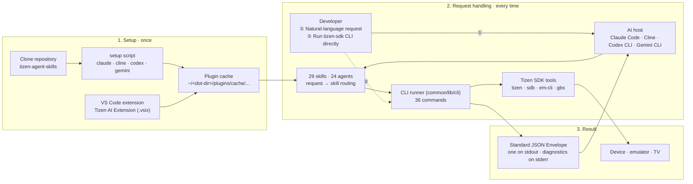
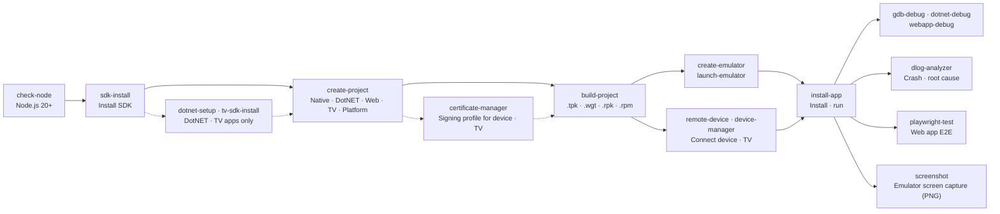

# tizen-sdk-skills Guide

English | [한국어](quick-guide.ko.md)

Reflects `main` after v1.6.0 (2026-10-26) · one-page summary (see README.md for details)

## 1. What is tizen-sdk-skills

**tizen-sdk-skills is a Tizen app development automation skill set: ask an AI coding agent in plain language and it runs the Tizen SDK tools for you.**



- Supported hosts: Claude Code, Cline, Codex CLI, Gemini CLI, VS Code extension, tizen-sdk CLI
- End-to-end automation: SDK install → project creation → build → install on emulator/device → remote debugging (GDB / netcoredbg / CDP) → Playwright tests
- Output: every command prints one Standard JSON Envelope on stdout. Diagnostic messages go to stderr only.
- Ways to run: **natural-language** requests to an AI host, or the **CLI** in a terminal or CI without a host. Both use the same runners.
- Safeguards: actions that are hard to undo — uninstalling or killing an app, reboot, root mode, factory reset, clearing logs — show the command first and run only after you confirm.

### 1.1 Natural-language requests

You don't need to memorize commands. Describe the task in English or Korean.

| Stage | What happens |
|-------|--------------|
| Request | Describe the task, for example "Build this project and install it on the emulator". |
| Routing | The request is routed to the matching skill (`tizen-build-project`, `tizen-install-app`, …). |
| Execution | The skill finds the installed SDK and runs `tizen` / `sdb` / `em-cli` commands. |
| Result | The result comes back as a Standard JSON Envelope, and the assistant summarizes it for you. |

Most skills are named `tizen-<command>` (for example `tizen-build-project`), and the CLI runs the same command as `tizen-sdk <command>`. A few commands, such as `list-templates` or `platform-list`, are reached through another skill.

## 2. Overall development flow



| Domain | Commands (36) |
|--------|---------------|
| SDK | `sdk-init`, `sdk-install`, `sdk-install-custom-repo`, `validate-repo-url`, `tv-sdk-install`, `tv-sdk-install-from-zip`, `update-package`, `sdk-repo-info`, `download-emulator-package`, `platform-install`, `platform-list`, `download-mobile-platform`, `install-rootstrap`, `dotnet-setup` |
| Check | `check-node`, `check-disk-space` |
| Project | `create-project`, `project-delete`, `list-templates`, `import-wgt`, `build-project` |
| Device | `create-emulator`, `launch-emulator`, `emulator-manager`, `device-manager`, `install-app`, `sdb-helper`, `screenshot`, `file-transfer`, `remote-device` |
| Debug | `gdb-debug`, `dotnet-debug`, `webapp-debug`, `dlog-analyzer` |
| Test | `playwright-test` |
| Certificate | `certificate-manager` |

> Dashed arrows are steps you take only when needed. DotNET apps need `dotnet-setup` first and TV apps need `tv-sdk-install`; installing on a real device or TV needs a signing profile (`certificate-manager`) and a device connection (`remote-device`).

## 3. Quick Start — install and make your first request

1. Prepare the prerequisites. You don't need to install the Tizen SDK beforehand.
   - Node.js 20+ (on `PATH`) and Git
   - OS: Windows, Linux or macOS. The emulator also works under WSL.
   - pnpm, only if you build the tizen-sdk CLI yourself
2. Clone the repository.
3. Run the setup script for your host.
4. Restart the host and start with **"Install the Tizen SDK"**.

```bash
git clone https://github.com/Samsung/tizen-agent-skills.git
cd tizen-agent-skills/tizen-sdk-skills
```

| Host | Install command (Linux/macOS · Windows) | After install |
|------|-----------------------------------------|---------------|
| Claude Code | `bash claude/setup/setup.sh` · `.\claude\setup\setup.ps1` | Restart the session |
| Cline | `bash cline/setup/setup.sh` · `.\cline\setup\setup.ps1` | Restart Cline or reload the VS Code window |
| Codex CLI | `bash codex/setup/setup.sh` · `.\codex\setup\setup.ps1` | Restart the host |
| Gemini CLI | `bash gemini/setup/setup.sh` · `.\gemini\setup\setup.ps1` | Restart the host |
| VS Code extension | `code --install-extension tizen-ai-extension-vX.Y.Z.vsix` | Installs on activation and merges hooks automatically |
| tizen-sdk CLI | `cd tizen-cli && pnpm install && pnpm run build` | `node bin/tizen-sdk.js --doctor` |

> **Note**: Project creation, builds, emulators, app installs and debugging all run SDK tools, so install the SDK first.
>
> **Note**: If the SDK is somewhere other than the default path (`~/tizen-sdk`), register it with "Set the Tizen SDK path to …" (`sdk-init`).

### 3.1 Checking results

**Natural-language request examples**

- `Create a Tizen web app named HelloTizen`
- `Build this project and install it on the emulator`
- `Debug this native app with GDB`
- `My app crashed — analyze the dlog`
- `Take a screenshot of the emulator`

**CLI status checks**

- `tizen-sdk --doctor`: reports the SDK path, cache and runner status.
- `tizen-sdk --capabilities`: shows which of the 36 commands are available right now.
- `tizen-sdk <command> --help`: shows that command's options. Before the build, you get a `PLUGIN_NOT_BUILT` envelope.

**New version notices**

- The hook installed by setup checks GitHub for a new release when a session starts (at most once a day) and shows a one-line notice.
- To update: run `git pull` in the clone you installed from, re-run the same setup script and restart the host.
- The VS Code extension has no session-start check, so watch the repository's Releases and install the new `.vsix` over the existing one.

> See CHANGELOG.md for the changes in each release.

## 4. Guide by user type

| I want to… | Use | Main topics |
|------------|-----|-------------|
| Try it in an AI host right away as a first-time user | **Quick Start** (section 3) | Run setup, install the SDK, natural-language requests |
| Install from inside the editor without scripts | **VS Code extension** | Install the `.vsix`, automatic sync, hook merge |
| Install on a real device or TV | **Certificate manager · remote device** | Create and select a signing profile (`certificate-manager`), connect a device by IP (`remote-device`), install the TV SDK |
| Use it in a terminal or CI without an AI host | **tizen-sdk CLI** | Build, `--doctor`, `--capabilities`, JSON output |
| Follow an end-to-end scenario | **Usage and walkthrough docs** | Native/Web/.NET apps, GDB·CDP·netcoredbg debugging, dlog, certificates, Playwright |
| Understand the structure or contribute | **Architecture docs · CONTRIBUTING.md** | `common/` single source, harness separation, test tiers, commit rules |

> Every harness mirrors the same `common/` into its own dot-dir cache. Harnesses differ only in where they load from and the agent file format, with one intended behavior difference:
>
> - Claude Code: long-running installs run in the background
> - Cline: no background completion notice, so they run in the foreground

## 5. Common problems

| Symptom | Cause and fix |
|---------|---------------|
| Skills are not recognized | Check that you restarted the host and re-run setup (it is idempotent) |
| The assistant's command is denied by a guard, then retried another way | Expected. The PreToolUse guard hook blocks common wrong command forms (such as a hand-typed `sdb`) and has the assistant retry through the right skill runner |
| `node` not found | Node.js 20+ must be on `PATH`. Ask "check node" (`check-node`) or run `node --version` |
| No update notice | Open `~/.tizen.agent.update.json`. `failed: false` means the check works: you are up to date, or the same notice was already shown in the last 24 hours (`notifiedAt`). `failed: true` carries an `error` code (recorded from the release after v1.6.0) |
| Certificate errors (`UNABLE_TO_VERIFY_LEAF_SIGNATURE`, …) | A corporate proxy re-signs HTTPS. Set `NODE_USE_SYSTEM_CA=1` or point `NODE_EXTRA_CA_CERTS` at the corporate root certificate, then restart |
| `PROXY_NEEDS_NODE_22_21` | `HTTPS_PROXY` is set but Node is older than 22.21. Upgrade Node |
| `RERUN_ETIMEDOUT` keeps repeating | Time `node -e 0`. If it takes tens of seconds, ask IT to exclude `node.exe` from real-time antivirus scanning |
| `TIMEOUT`, `ENOTFOUND`, `HTTP_<status>` | Network problem or GitHub is unreachable. A failed check retries after 4 hours |
| Uninstall | The VS Code extension cleans up on uninstall. For script installs, delete the cache root, the `tizen-*` skills and agents, and the hook/instruction entries |

## 6. Key locations

| Item | Location |
|------|----------|
| GitHub repository | Samsung/tizen-agent-skills |
| Plugin cache | `~/<dot-dir>/plugins/cache/tizen-platform/tizen-sdk-skills/<version>/` |
| SDK path setting | `~/.tizen.sdk.path.config` |
| Update check result | `~/.tizen.agent.update.json` |
| Shared source | `common/` (skills, agents, lib, scripts, hooks, setup) |
| tizen-sdk CLI | `tizen-cli/` |
| Release artifacts | `tizen-sdk-vX.Y.Z.zip`, `tizen-ai-extension-vX.Y.Z.vsix` on GitHub Releases |
| License | Apache License 2.0 · Copyright 2026 Samsung Electronics Co., Ltd. |
| Contact | GitHub Issues (Samsung/tizen-agent-skills) |
